<!-- =============== ARCADE PROFILE · edit the lines marked ✏️ =============== -->

<p align="center">
  
</p>

<p align="center">
  
</p>

<p align="center">
  
  <a href="https://parampara-web.onrender.com"></a>
</p>

<br/>

<!-- ======================= STAGE 1 ======================= -->


<table align="center">
<tr>
<td width="58%" valign="top">

```yaml
player:      Trisha Khajuria
class:       Full Stack Developer
level:        B.E CSE · Third Year
guild:        Chitkara University
home_base:   Himachal Pradesh, India
main_weapon: Java
combo:       MongoDB + Express + React + Node
side_quest:  AI / ML
now_playing: ParamPara (family heritage platform)
next_level:  ML
fun_fact:    i like cats and coding stuff
```

</td>
<td width="42%" valign="top">

**Character stats**

```text
FRONTEND  ▰▰▰▰▰▰▰▰▱▱  80
BACKEND   ▰▰▰▰▰▰▰▱▱▱  70
JAVA/DSA  ▰▰▰▰▰▰▰▰▱▱  80
DATABASE  ▰▰▰▰▰▰▱▱▱▱  60
AI / ML   ▰▰▰▰▰▱▱▱▱▱  50
COFFEE    ▰▰▰▰▰▰▰▰▰▰  MAX
```


</td>
</tr>
</table>

<!-- ======================= STAGE 2 ======================= -->


<p align="center">
  <b>⚔️ Weapons</b><br/>
  
</p>
<p align="center">
  <b>🛡️ Armor (frontend)</b><br/>
  
</p>
<p align="center">
  <b>🧪 Potions (backend &amp; data)</b><br/>
  
</p>
<p align="center">
  <b>🗺️ Tools</b><br/>
  
</p>


<!-- ======================= STAGE 3 ======================= -->


<p align="center">
  <a href="https://github.com/ohathena/ParamPara-Family-Memory-Reservoir">
    
  </a>
  <!-- ✏️ second quest: replace YOUR_REPO -->
  <a href="https://github.com/ohathena/YOUR_REPO">
    
  </a>
</p>

| 🕹️ Quest | 🎯 Mission | 🧰 Loadout | 🏆 Loot |
|---|---|---|---|
| **[ParamPara](https://parampara-web.onrender.com)** | Private family tree and memory archive with roles, comments and photo uploads | React · Node · Express · MongoDB · Tailwind | 53 tests · deployed for ₹0/month |
<!-- | ✏️ **Project 2** | ✏️ one line about what it does | ✏️ tech | ✏️ result / users / award |
| ✏️ **Project 3** | ✏️ | ✏️ | ✏️ | -->

<!-- ======================= STAGE 4 ======================= -->


<p align="center">
  
  
</p>
<p align="center">
  
</p>

<!-- ======================= STAGE 5 ======================= -->


<p align="center">
  
</p>

<!-- ======================= CONTINUE ======================= -->


<p align="center">
  <!-- ✏️ replace the links -->
  <a href="https://www.linkedin.com/in/trisha-khajuria/"></a>
  <a href="mailto:trishakhajuria887@gmail.com"></a>
 
  <a href="https://leetcode.com/u/FuBuKi76/"></a>
</p>

<p align="center">
  
</p>
